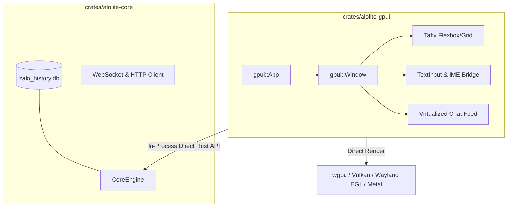

# ROADMAP: GPUI Native Frontend Spike (`crates/alolite-gpui`)

**Branch**: `experiment/gpui`  
**Reference Target**: Discord Project Phoenix (Rust + GPUI) & Zed Editor  
**Objective**: Build and evaluate a pure GPU-accelerated desktop messaging client frontend in Rust using **GPUI**, eliminating Chromium/WebKit runtime dependencies while targeting **< 100 MB RSS RAM**, sub-25ms cold start, and 120 FPS rendering.

---

## 1. Architecture Map

The shared domain core (`crates/alolite-core`) remains completely decoupled. `alolite-gpui` communicates with `CoreEngine` via in-process Rust asynchronous APIs without any IPC, HTTP, or WebView serialization layer:

```
crates/
├── alolite-core/         # Pure domain engine: protocol, SQLite, session, crypto, Tokio
├── alolite-cli/          # Headless CLI, daemon & MCP server
├── alolite-desktop/      # [STABLE - main branch] Tauri v2 + React 19 + shadcn UI
└── alolite-gpui/         # [EXPERIMENT - this branch] Pure Native Rust GPU frontend (GPUI)
```



---

## 2. Go / No-Go Decision Matrix

| Gate | Focus Area | Success Criterion (Go) | Status |
| :--- | :--- | :--- | :--- |
| **Gate 1** | **Vietnamese IME & Input** | 100% correct text input with `ibus-bamboo`, `fcitx5`, and `Unikey` on Wayland/X11 without double characters or dropped diacritics | **PASSED** (Verified on Arch Linux Wayland + Fcitx5) |
| **Gate 2** | **Core Data & Virtualization** | Loads 32 threads + 1,000+ messages from `zalo_history.db` smoothly at 60/120 FPS via `gpui::uniform_list` | In Progress (Phase 2) |
| **Gate 3** | **Memory & Assets** | Total runtime RSS **< 100 MB** with real database and avatar images | Pending (Phase 3) |

> ⚠️ **Fail-Fast Rule**: If **Gate 1** fails, the branch will be immediately parked and documented upstream to Zed GPUI. No subsequent phases will be executed until upstream resolves Linux IME support.

---

## 3. Milestones & Work Breakdown

### Phase 0: Scaffolding & Setup (Estimated: 0.5 Day) [COMPLETED]
- [x] Create `crates/alolite-gpui` and register in workspace `Cargo.toml`.
- [x] Pin `gpui` dependency (`gpui = "0.2.2"` with `libc = "=0.2.186"`).
- [x] Implement bare-minimum `src/main.rs` opening an empty GPUI window.
- [x] Verify clean build: `cargo check -p alolite-gpui` on Arch Linux Wayland & X11.

### Phase 1: Gate 1 — Vietnamese IME & Keyboard Input (Estimated: 1 Day) [COMPLETED]
- [x] Port `TextInput` component from GPUI examples into `crates/alolite-gpui/src/input.rs`.
- [x] Implement `gpui::EntityInputHandler` and connect Wayland / X11 IME composition hooks.
- [x] Execute Vietnamese IME test matrix on Wayland + Fcitx5:
  - Test sentence: `Cộng hòa Xã hội Chủ nghĩa Việt Nam — Độc lập Tự do Hạnh phúc — 123456789`
  - Confirmed: 100% correct input, no character doubling, pre-edit underline and UTF-16 metrics accurate.
- [x] **Checkpoint Gate 1**: Formal evaluation and sign-off completed (PASS).

### Phase 2: Gate 2 — Two-Pane Layout & Virtualized Feed (Estimated: 2 Days)
- [ ] Initialize `CoreEngine` inside GPUI's async background executor (`cx.background_executor()`).
- [ ] Build two-pane layout using GPUI's Taffy flexbox:
  - **Left Pane (280px)**: Thread list (avatar, sender name, preview text, unread badge).
  - **Right Pane (Flex-1)**: Active chat feed with virtualized message items.
- [ ] Implement thread selection state (`selected_thread_id`) and reactive feed switching.
- [ ] **Checkpoint Gate 2**: Smooth scrolling with realistic historical chat data.

### Phase 3: Gate 3 — Media Pipeline & Outbound Chat (Estimated: 2 Days)
- [ ] Connect image cache pipeline: read disk bytes from `alolite-core`, decode with `image` crate, and blit to GPUI texture quads.
- [ ] Wire bottom Composer: type text -> press `Enter` -> call `CoreEngine::send_text`.
- [ ] Subscribe to `CoreEvent` stream (optimistic local echo + WebSocket server acknowledgement).
- [ ] Implement basic popover menu / confirmation dialog for thread actions.

### Phase 4: Benchmarking, Documentation & Comparison (Estimated: 1 Day)
- [ ] Measure exact memory metrics using `/proc/<pid>/smaps_rollup`:
  - RSS, PSS, and Private_Dirty.
- [ ] Measure cold-start latency to first painted frame.
- [ ] Produce comparative report against `alolite-desktop` (Tauri v2) and `alolite` (egui).
- [ ] Final architecture review: determine whether to maintain dual-engine or merge.

---

## 4. Empirical Benchmark Targets

| Metric | Target (`alolite-gpui`) | Baseline (`alolite-desktop` Tauri) | Baseline (`alolite` egui) |
| :--- | :--- | :--- | :--- |
| **Runtime Engine** | Pure GPU Shaders (`wgpu`) | WebKitGTK 4.1 (`libsoup3`) | OpenGL Immediate (`egui`) |
| **OS Processes** | **1** | 3 | 1 |
| **Target RSS** | **< 100 MB** | ~536 MB | ~192 MB |
| **Private Dirty** | **< 40 MB** | ~225 MB | ~65 MB |
| **Stripped Binary**| **< 25 MB** | ~17 MB | ~8.9 MB |
| **Cold Start** | **< 25 ms** | ~250 ms | ~15 ms |
