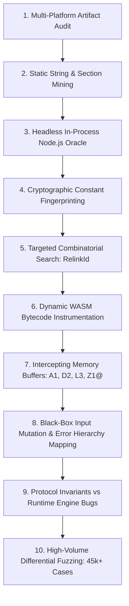

# 11 — Trusted Device Protocol (Companion Linking & Trust Verification)

Date: 2026-11-07  
Status: Ground-Truth Verified  
Evidence tags: **[O]** Observed in binary / bundle, **[V]** Verified via differential testing against reference WASM oracle.

> **Activation gate (re-verified 2026-11-07):** the whole protocol is dormant unless the login-time
> server flag `getServerInfo` → `setttings.authen.trusted_device.qr_format_trust_device` is `1`.
> The reference client uses that one flag for both the `reqqr` `qr_form` argument and the QR payload
> format, and every live Zalo auth host answered `0`. See
> [note 10 §1.2.1](10_trusted_device_and_bio_sync.md) for the evidence and the Alolite mapping
> (`Session::qr_format_trust_device`, `ZALO_QR_TRUSTED=1|0` override).


---

## 1. Executive Summary & Artifact Provenance

In Zalo Desktop, the **Trusted Device Protocol** governs **Companion Cryptographic Linking** (`qr_form: 1` during QR login) and **Device List Trust Verification**, allowing desktop and web companions to establish verified cryptographic trust with the primary mobile device.

### 1.1 Universal Artifact Ground Truth [O, V]
An exhaustive multi-platform audit of official Zalo distributions confirmed that **for the Trusted Device Protocol itself, no native dynamic library exists on any OS** (unrelated local/media features ship 15 OS-specific N-API addons in `app.asar.unpacked/native/nativelibs/`; see [note 12 §2.3](12_message_sync_and_e2ee_protocol.md)). The Trusted Device protocol is executed universally via WebAssembly inside Electron Web Workers (`trust-worker.*.js`):

| Distribution | Source Container | Resolved Artifact Path | File SHA-256 |
|:---|:---|:---|:---|
| **Linux** | `zalo-for-linux/app/pc-dist` | `libs/trusted_device_protocol_bg.97af2bf51fb002cefc5a888e932bcab2.wasm` | `716f0a0637e5b64168010899f4ad380be7d0c6a67778137c88ecb2ff9d9e49da` |
| **macOS Universal** | `ZaloSetup-universal-26.11.10.dmg` (`app.asar`) | `/pc-dist/libs/trusted_device_protocol_bg.97af2bf51fb002cefc5a888e932bcab2.wasm` | `716f0a0637e5b64168010899f4ad380be7d0c6a67778137c88ecb2ff9d9e49da` |
| **Windows** | `ZaloSetup-26.11.10.exe` (`resources/app.asar`) | `/pc-dist/libs/trusted_device_protocol_bg.97af2bf51fb002cefc5a888e932bcab2.wasm` | `716f0a0637e5b64168010899f4ad380be7d0c6a67778137c88ecb2ff9d9e49da` |

### 1.2 Binary Build Profile
- **Size**: 346,340 bytes (338 KB).
- **Format**: WebAssembly binary (`wasm 0x1`), 11 sections, 331 functions, symbols stripped.
- **Compiler toolchain**: `rustc 1.83.0 (aarch64-apple-darwin)` via `wasm-bindgen 0.2.100 (2405ec2b4)` & `walrus 0.23.3`.
- **Crate dependencies observed**:
  - `curve25519-dalek 4.1.3` (Edwards & Montgomery scalar arithmetic, XEdDSA)
  - `base91 0.1.0` (canonical basE91 QR payload encoder)
  - `base64 0.22.1` (general-purpose standard engine with padding)
  - `bytes 1.11.1` (buffer operations)
  - `prost`-like custom proto3 codec (field merging, varint decoding)
  - `once_cell 1.21.3`, `log-panics 2.1.0`, `dlmalloc 0.2.6`, `hashbrown 0.15.0`.

---

## 2. Reverse Engineering Methodology Playbook

This section details the exact technical playbook used to reverse-engineer this closed-source, stripped WebAssembly binary from scratch. Future engineering agents should follow this step-by-step strategy when analyzing unknown cryptographic modules.



### Step 1: Multi-Platform Artifact Audit (Checking for Native Symbols)
- **Goal**: Check if an unstripped native binary (`.so`, `.dylib`, `.dll`) exists on any platform before analyzing stripped WebAssembly.
- **Action**:
  1. Extracted and parsed the ASAR headers of both `ZaloSetup-universal-26.11.10.dmg` and `Zalo-Win-26.11.10.7z` without full archive extraction.
  2. Located all files matching `*trust*`, `*zproto*`, and `*.wasm`.
  3. Computed SHA-256 digests across all platforms.
- **Finding**: All platforms use the exact same WASM file (`716f0a0637...`). There are no native counterparts. The protocol is platform-independent.

### Step 2: Static String & Section Mining
- **Goal**: Identify compiler, dependencies, error messages, and protocol strings from the stripped binary.
- **Action**:
  1. Dumped data segments using custom LEB128 parser in Python.
  2. Mined panic messages, crate registry URLs, and format strings:
     - Discovered `curve25519-dalek-4.1.3`, `base91-0.1.0`, `base64-0.22.1`.
     - Found error message taxonomy: `invalid <primary_linking_data> data encoding`, `invalid linking MAC`, `invalid account signature`, `invalid device signature`, `no key type identifier`, `bad key type <{:#04x}>`, `bad key length <{}> for key with type <Djb>`.
     - Found protobuf message names: `LinkingDataProto`, `LinkingMetadataProto`, `DeviceListProto`, `CompanionDataProto`, `CompanionDeviceProto`.

### Step 3: Headless In-Process Node.js Oracle
- **Goal**: Run the reference WASM as a deterministic oracle without launching Electron or Chrome.
- **Action**:
  1. Located module `Wxr4` in `trust-worker.cfeba43a9a8e4e40dda3.js` containing the `wasm-bindgen` glue and heap management.
  2. Extracted the self-contained JS closure and wrapped it with minimal webpack require shims (`3UD+` harmony export, `yLpj` globalThis).
  3. Built an oracle harness (`oracle.js`) that instantiates the WASM via `WebAssembly.instantiate` using Node's `fs.readFileSync`.
  4. Verified exported functions:
     - `g()`: `zprotoEd25519GenerateKeyPair`
     - `l()`: `zprotoTrustGenerateLinkingSecretKey`
     - `k()`: `zprotoTrustGenerateLinkingQr`
     - `m()`: `zprotoTrustGetRelinkId`
     - `j()`: `zprotoTrustCreateCompanionLinkingProof`
     - `n()`: `zprotoTrustVerifyDeviceListFromBytes`
     - `o()`: `zprotoTrustVerifyDeviceListFromStruct`
     - `p()`: `zprotoTrustVerifyTrustedIdentity`
     - `i()`: `zprotoTrustCheckExpiryTime`

### Step 4: Cryptographic Constant Fingerprinting
- **Goal**: Identify hash functions, ciphers, and curves without decompiling 331 stripped functions.
- **Action**:
  1. Scanned linear memory and WAT code for cryptographic initialization vectors and round constants:
     - Found SHA-256 K-constants: `1116352408` (`0x428a2f98`), `1899447441` (`0x71374491`).
     - Found SHA-512 K-constants: `4794697086780616226` (`0x428a2f98d728ae22`).
     - Found ChaCha20 constant: `1634760805` (`"expa"`).
     - Verified absence of AES s-boxes (`637c777b...`) and Poly1305 constants.
  2. Tested key generation:
     - Public key is 33 bytes with prefix `0x05`.
     - Clamped private key scalar multiplied with X25519 base point `9` matched `publicKey[1..33]` identically.
     - Confirmed Signal/Djb Curve25519 identity key convention.

### Step 5: Targeted Combinatorial Search (Solving `relinkId`)
- **Goal**: Determine how `zprotoTrustGetRelinkId(primaryIK, companionIK, secret, ts)` produces its 32-byte output.
- **Action**:
  1. Tested output length: exactly 32 bytes (HMAC-SHA256 or SHA-256).
  2. Permuted input components: `primaryIK` (33B vs 32B), `companionIK` (33B vs 32B), `secret` (32B), `ts` (LE64, BE64, varint, string).
  3. Ran all permutations through SHA-256, HMAC-SHA256, SHA-512 with each key candidate.
  4. **Instant Match**:
     $$\text{relinkId} = \text{HMAC-SHA256}(\text{linkingSecret}, \text{LE64}(\text{ts}) \parallel \text{companionIK}_{33} \parallel \text{primaryIK}_{33})$$

### Step 6: Dynamic WASM Bytecode Instrumentation (The Key Breakthrough)
- **Problem**: In `createCompanionLinkingProof` and `verifyDeviceListFromBytes`, signatures failed with `invalid account signature` or `invalid device signature`. The message passed into the signature verifier was assembled dynamically inside compiled Rust code and not exposed to JavaScript.
- **Technique**:
  1. Located the SHA-512 compression function in WAT text: `(func $f68 (param $p0 i32) (param $p1 i32) (param $p2 i32))` containing the unrolled K-constant `4794697086780616226`.
  2. Added a custom debug import to the WAT module:
     ```wat
     (import "dbg" "sha512" (func $dbg_sha512 (param i32 i32 i32)))
     ```
  3. Injected a hook at the entry of `$f68`:
     ```wat
     local.get $p0
     local.get $p1
     local.get $p2
     call $dbg_sha512
     ```
  4. Re-assembled the module with `wat2wasm td_dbg.wat -o td_dbg.wasm`.
  5. In Node.js, supplied a hook callback reading WASM linear memory:
     - Intercepted the exact block pointers and lengths passed to every SHA-512 compression call.
     - Detected hash restarts by checking when state pointer equaled the initial SHA-512 IV (`0x6a09e667f3bcc908`).
     - Unpadded the message from the 128-byte block using the 64-bit big-endian bit length trailer.

### Step 7: Domain Separator & Message Recovery
- **Result of Instrumentation**:
  The unpadded SHA-512 input revealed the complete XEdDSA $R \parallel A \parallel M$ structure directly:
  1. **Primary Account Signature ($M_{\text{account}}$)**:
     $$\text{Prefix} = \text{"A1"} \quad (\text{0x41 0x31})$$
     $$M_{\text{account}} = \text{"A1"} \parallel \text{encode}(\text{LinkingMetadataProto fields 1..5}) \parallel \text{companionIK}_{33}$$
     *(Revealed that field 6 `platform` is excluded from the primary account signature).*
  2. **Companion Device Signature ($M_{\text{device}}$)**:
     $$\text{Prefix} = \text{"D2"} \quad (\text{0x44 0x32})$$
     $$M_{\text{device}} = \text{"D2"} \parallel \text{encode}(\text{canonical LinkingMetadataProto fields 1..6}) \parallel \text{companionIK}_{33} \parallel \text{primaryIK}_{33}$$
  3. **Device List Signature ($M_{\text{list}}$)**:
     $$\text{Prefix} = \text{"L3"} \quad (\text{0x4C 0x33})$$
     $$M_{\text{list}} = \text{"L3"} \parallel \text{master\_id} \parallel \text{primaryIK}_{33} \parallel \text{LE64}(\text{ts}) \parallel \text{CompanionDataProto}$$
  4. **QR Code Prefix**:
     $$\text{Prefix} = \text{"Z1@"}$$

### Step 8: Black-Box Input Mutation & Error Hierarchy Mapping
- **Goal**: Map out the exact validation order across all arguments and nested struct fields.
- **Action**:
  1. Created pairs of conflicting invalid inputs (e.g. `bad_platform` vs `bad_secret`, `invalid_base64` vs `invalid_key_type`).
  2. Recorded which error code and message surfaced first.
  3. Extracted the complete precedence hierarchy:
     - For `generateLinkingQR`: Key parsing $\rightarrow$ Secret length $\rightarrow$ Platform enum.
     - For `createCompanionLinkingProof`: Public key $\rightarrow$ Private key $\rightarrow$ Secret length $\rightarrow$ Platform enum $\rightarrow$ Protobuf decode $\rightarrow$ Metadata presence $\rightarrow$ MAC $\rightarrow$ Primary key $\rightarrow$ Account signature.
     - For `verifyDeviceListFromStruct`: Two-pass conversion (Pass 1: base64 decodes, linkId, range checks; Pass 2: companion enum mapping).

### Step 9: Disentangling Protocol Invariants vs Runtime Engine Bugs
- **Discovery 1: BTreeMap Deduplication & Sorting**:
  Fuzzing device lists revealed that entries with identical `companion_id` collapse to the last entry, and emitted messages sort entries strictly by `companion_id` ascending. Both list signature evaluation and lookup enforce this order.
- **Discovery 2: The CompanionId Getter 8-Bit Bug**:
  When companion IDs exceeded 255 (e.g. $2^{31}$), the WASM oracle returned `cid: 0` or `cid: 255` in JavaScript, while the encoded metadata bytes retained the full 32-bit varint. Analyzing the generated `wasm-bindgen` JS glue revealed that the compiler merged function 297 with an 8-bit boolean/status getter (`i.zprototrustcompanionlinkingdata_companionId`), causing JavaScript to read only the lowest byte of the struct offset. The underlying wire protocol correctly handles `u32`.

### Step 10: High-Volume Differential Fuzzing
- **Action**:
  1. Wrote a dual-engine test harness (`fuzz.js`) executing the reference WASM and the clean-room Rust binary side-by-side over standard I/O.
  2. Executed **45,000+ randomized test cases** across 6 distinct pseudo-random seeds covering valid handshakes, malformed protobufs, bit-flipped signatures, boundary timestamps, and corrupted keys.
  3. Reached **zero mismatches** across all protocol operations.

---

## 3. Detailed Cryptographic Specification

### 3.1 Public & Private Identity Keys
- Public keys use **Signal/Djb format**:
  - Length: exactly 33 bytes.
  - Byte 0: `0x05` (Curve25519 Djb type identifier).
  - Bytes 1..33: Little-endian X25519 Montgomery $u$-coordinate.
- Private keys:
  - Length: exactly 32 bytes (clamped scalar $a$).
  - Clamping:
    $$a[0] \ \&= 248, \quad a[31] \ \&= 127, \quad a[31] \ |= 64$$
  - Base point multiplication: $A_u = \text{X25519}(a, 9)$.

### 3.2 XEdDSA Signature Scheme
Signatures are 64 bytes: $R \parallel s$.
- **Signing**:
  1. Compute Montgomery-to-Edwards public key $A_E = a \cdot B$.
  2. Determine sign bit: $\text{sign\_bit} = A_E.\text{compress}()[31] \ \& \ \text{0x80}$.
  3. Derive nonce scalar $r$:
     $$r = \text{Scalar::from\_hash}(\text{SHA-512}(\text{0xFE} \parallel \text{0xFF}^{31} \parallel a \parallel M \parallel Z_{64}))$$
     where $Z_{64}$ is fresh CSPRNG entropy.
  4. Compute commitment point $R = r \cdot B$.
  5. Compute challenge scalar $h$:
     $$h = \text{Scalar::from\_hash}(\text{SHA-512}(R.\text{compress}() \parallel A_E.\text{compress}() \parallel M))$$
  6. Calculate signature scalar: $s = h \cdot a + r \pmod L$.
  7. Pack sign bit into highest bit of signature:
     $$\text{signature}[0..32] = R.\text{compress}(), \quad \text{signature}[32..64] = s.\text{to\_bytes}()$$
     $$\text{signature}[63] = (\text{signature}[63] \ \& \ \text{0x7F}) \ | \ \text{sign\_bit}$$

- **Verification**:
  1. Extract sign bit: $\text{sign\_bit} = (\text{signature}[63] \ \& \ \text{0x80}) \gg 7$.
  2. Clear sign bit from scalar bytes: $s[31] \ \&= \text{0x7F}$.
  3. Validate scalar bounds: $s[31] \ \& \ \text{0xE0} == 0$ (must be reduced modulo curve order $L$).
  4. Convert Montgomery $u$ to Edwards point $A$:
     $$y = (u - 1) / (u + 1) \pmod p$$
     Decompress $(y, \text{sign\_bit})$ into $A_E$.
  5. Compute challenge $h = \text{Scalar::from\_hash}(\text{SHA-512}(R \parallel A_E.\text{compress}() \parallel M))$.
  6. Constant-time check:
     $$s \cdot B - h \cdot A_E \stackrel{?}{=} R$$

### 3.3 Relink Identifier
Used by a companion on subsequent QR logins to prove prior relationship:
$$\text{relinkId} = \text{HMAC-SHA256}(\text{linkingSecret}, \text{LE64}(\text{ts}) \parallel \text{companionIK}_{33} \parallel \text{primaryIK}_{33})$$

### 3.4 Linking Message Authentication Code (MAC)
Authenticates the phone's QR-scan response to the companion:
$$\text{linkingMAC} = \text{HMAC-SHA256}(\text{linkingSecret}, \text{linkingDataBytes} \parallel \text{primaryIK}_{33})$$
*Notice: `primaryIK` is appended to the raw `linkingDataBytes` before hashing.*

---

## 4. Protobuf Wire Schemas & Signatures

All messages use standard Proto3 wire encoding. Default scalar values ($0$, `""`, empty bytes) are omitted on the wire.

### 4.1 `LinkingQr`
Encodes the companion's public identity key and parameters into the QR code.
- **Prefix**: `"Z1@"`
- **Encoding**: basE91 (`base91-0.1.0` canonical alphabet)

| Tag | Field | Wire Type | Rust Type | Description |
|:---|:---|:---|:---|:---|
| 1 | `token` | 2 (Length-delimited) | `string` | Nonce token from `/api/login/reqqr` |
| 2 | `companion_ik` | 2 (Length-delimited) | `bytes` (33B) | Companion public key (`0x05 || u`) |
| 3 | `linking_secret` | 2 (Length-delimited) | `bytes` (32B) | Fresh secret (omitted on relink) |
| 4 | `timestamp` | 0 (Varint) | `uint64` | Unix milliseconds |
| 5 | `platform` | 0 (Varint) | `uint32` | Companion platform: `0 = Web`, `1 = Pc` |
| 6 | `relink_id` | 2 (Length-delimited) | `bytes` (32B) | Present on relink |

### 4.2 `LinkingDataProto` & `LinkingMetadataProto`
Delivered to companion via `chk_wait_scan` as `{ enc_link_data, enc_link_hmac }`.

#### `LinkingDataProto`
| Tag | Field | Wire Type | Rust Type | Description |
|:---|:---|:---|:---|:---|
| 1 | `metadata` | 2 (Length-delimited) | `LinkingMetadataProto` | Inner metadata message |
| 2 | `account_signature` | 2 (Length-delimited) | `bytes` (64B) | Primary account XEdDSA signature |
| 3 | `linking_timestamp` | 1 (Fixed64) | `fixed64` | Primary linking timestamp (ms) |

#### `LinkingMetadataProto`
| Tag | Field | Wire Type | Rust Type | Description |
|:---|:---|:---|:---|:---|
| 1 | `master_id` | 2 (Length-delimited) | `string` | Primary user ID |
| 2 | `primary_ik_public` | 2 (Length-delimited) | `bytes` (33B) | Primary identity public key |
| 3 | `companion_ik_public` | 2 (Length-delimited) | `bytes` (33B) | Companion identity public key |
| 4 | `companion_id` | 0 (Varint) | `uint32` | Assigned companion index |
| 5 | `link_id` | 0 (Varint) | `uint64` | Unique link pairing ID |
| 6 | `platform` | 0 (Varint) | `int32` | Wire platform (`0 = Web`, `1 = Pc`) |

#### Signature Formats:
- **Primary Account Signature ($M_{\text{account}}$)**:
  $$M_{\text{account}} = \text{0x41 0x31} \parallel \text{encode}(\text{LinkingMetadataProto}_{\text{fields 1..5}}) \parallel \text{companionIK}_{33}$$
- **Companion Counter-Signature ($M_{\text{device}}$)**:
  $$M_{\text{device}} = \text{0x44 0x32} \parallel \text{encode}(\text{LinkingMetadataProto}_{\text{canonical 1..6}}) \parallel \text{companionIK}_{33} \parallel \text{primaryIK}_{33}$$

### 4.3 `DeviceListProto`
The signed authorization registry of all companion devices linked to an account.

| Tag | Field | Wire Type | Rust Type | Description |
|:---|:---|:---|:---|:---|
| 1 | `master_id` | 2 (Length-delimited) | `string` | Primary user ID |
| 2 | `identity_key` | 2 (Length-delimited) | `bytes` (33B) | Primary identity public key |
| 3 | `companion_list` | 2 (Length-delimited) | `bytes` | Serialized `CompanionDataProto` |
| 4 | `timestamp` | 1 (Fixed64) | `fixed64` | List issuing timestamp (ms) |
| 5 | `signature` | 2 (Length-delimited) | `bytes` (64B) | Primary XEdDSA list signature |

#### `CompanionDataProto`
| Tag | Field | Wire Type | Rust Type | Description |
|:---|:---|:---|:---|:---|
| 1 | `data` | 2 (Length-delimited, repeated) | `CompanionDeviceProto` | Repeated companion device records |

#### `CompanionDeviceProto`
| Tag | Field | Wire Type | Rust Type | Description |
|:---|:---|:---|:---|:---|
| 1 | `companion_id` | 0 (Varint) | `uint32` | Companion slot number |
| 2 | `public_identity_key` | 2 (Length-delimited) | `bytes` (33B) | Companion public key |
| 3 | `link_id` | 0 (Varint) | `uint64` | Pairing identifier |
| 4 | `device_type` | 0 (Varint) | `int32` | Wire platform (`0 = Web`, `1 = Pc`) |
| 5 | `device_status` | 0 (Varint) | `int32` | `0 = Stale`, `1 = Active` |
| 6 | `account_signature` | 2 (Length-delimited) | `bytes` (64B) | Primary account signature |
| 7 | `device_signature` | 2 (Length-delimited) | `bytes` (64B) | Companion device signature |
| 8 | `expiration` | 0 (Varint) | `uint64` | Expiry timestamp (ms) |

#### List Signature Format ($M_{\text{list}}$):
$$M_{\text{list}} = \text{0x4C 0x33} \parallel \text{master\_id} \parallel \text{primaryIK}_{33} \parallel \text{LE64}(\text{ts}) \parallel \text{CompanionDataProtoBytes}$$

---

## 5. Lifecycle Rules, Algorithms & Precedence

### 5.1 Device List Validation Algorithm
Implemented in `verify_device_list_from_bytes(device_list, primary_ik, verify_at, companion_ik)`:

1. **Primary Key Match**: Compare `primary_ik` against `device_list.identity_key`.
   - Mismatch $\rightarrow$ `DeviceListError::WrongPrimaryIdentityKey` (`3`).
2. **List Signature Verification**: Verify primary XEdDSA signature over $M_{\text{list}}$.
   - Invalid $\rightarrow$ `DeviceListError::InvalidDeviceListSignature` (`1`).
3. **Companion Lookup (if `companion_ik` supplied)**:
   - Search `device_list.companions` by matching 33-byte public key.
   - Not found $\rightarrow$ `DeviceListError::CompanionDeviceDoesNotExist` (`6`).
4. **Companion Signature Verification**:
   - Verify companion XEdDSA signature over $M_{\text{device}}$ using `companion.public_identity_key`.
   - Invalid $\rightarrow$ `DeviceListError::InvalidCompanionDeviceSignature` (`4`).
5. **Stale Device Expiration Check**:
   - If companion status is `Stale` (`0`) and $\text{verify\_at} > \text{companion.expiration}$:
     $\rightarrow$ `DeviceListError::StaleCompanionDeviceHasExpired` (`5`).
6. **List TTL Expiration Check**:
   - Compute $\text{expiry} = \text{device\_list.timestamp} + \text{DEVICE\_LIST\_TTL\_MS}$ ($21 \text{ days} = 1,814,400,000 \text{ ms}$).
   - If overflow occurs $\rightarrow$ `ErrorCode::TimeOverflow` (`8`).
   - If $\text{verify\_at} > \text{expiry} \rightarrow$ `DeviceListError::DeviceListHasExpired` (`2`).
7. **Success**: `is_trusted = true`, `error = None`.

### 5.2 Expiry Computation (`check_expiry_time`)
Given `(device_list, companion_ik, now)`:
- If companion is not found: `is_expired = true`, `remaining_time = 0`, `companion_device_status = None`.
- If status is `Active` (`1`):
  $$\text{expiry} = \text{list.timestamp} + 1,814,400,000$$
- If status is `Stale` (`0`):
  $$\text{expiry} = \text{device.expiration}$$
- State evaluation:
  $$\text{is\_expired} = (\text{now} \ge \text{expiry})$$
  $$\text{remaining\_time} = \text{clamp\_i64}(\text{expiry} - \text{now})$$

---

## 6. Complete Error Code Taxonomy

| Code | Identifier | Exact English Message Format | Trigger Condition |
|:---|:---|:---|:---|
| `7` | `ParseIntError` | `cannot parse <{field}> into integer, error: {err}` | Non-numeric string in `linkId` |
| `8` | `TimeOverflow` | `failed to calculate time value due to numeric overflow` | $\text{timestamp} + \text{TTL}$ overflows `u64` |
| `10` | `InternalError` | `internal error: ...` | OS random source failure |
| `101` | `InvalidKeySize` | `invalid key size: {name} with size <{len}>` | Secret length $\ne 32$ or primary key length $\ne 33$ |
| `101` | `InvalidKeySize` | `bad key length <{len}> for key with type <Djb>` | Key length $< 33$ |
| `102` | `InvalidKeyType` | `no key type identifier` | Empty public key slice |
| `102` | `InvalidKeyType` | `bad key type <{:#04x}>` | First byte $\ne \text{0x05}$ |
| `103` | `UnknownAlgorithm` | `CryptoError: unknown <> algorithm <>` | Unrecognized algorithm identifier |
| `104` | `InvalidQrUtf8Token` | `invalid UTF8 string` | QR token slice is not valid UTF-8 |
| `105` | `InvalidQrPrefix` | `invalid QR prefix` | QR string does not start with `"Z1@"` |
| `106` | `InvalidQrFormat` | `invalid QR format` | Malformed basE91 QR payload |
| `107` | `UnsupportedQrVersion` | `unsupported QR version <{}>` | Version byte mismatch |
| `109` | `InvalidDataEncoding` | `invalid <{field}> data encoding` | Protobuf wire type mismatch or invalid enum |
| `109` | `InvalidDataEncoding` | `invalid base64 encoding for <{field}>, error: {err}` | Invalid base64 characters or padding |
| `111` | `InvalidLinkingMac` | `invalid linking MAC` | HMAC-SHA256 mismatch in linking response |
| `112` | `InvalidAccountSignature` | `invalid account signature` | Primary account XEdDSA signature fails |
| `113` | `InvalidDeviceSignature` | `invalid device signature` | Companion device XEdDSA signature fails |
| `114` | `InvalidDeviceStatus` | `invalid device status <{value}>` | Status value outside $[0, 2]$ |
| `116` | `InvalidDeviceType` | `invalid device type <{value}>` | Platform value outside $[0, 2]$ or platform = Mobile |
| `117` | `InvalidInputDeviceListStruct` | `invalid jsDeviceList struct` | Missing field, wrong JSON type |

---

## 7. Known-Answer Test Vectors (KAT)

Generated deterministically from the reference WASM oracle and committed to `tests/fixtures/trusted_device_kat.json`:

```json
{
  "prPriv": "4042424242424242424242424242424242424242424242424242424242424242",
  "prPub": "05132c442be010fbd57e72603328aa76e71fccc1503aae219327d14d9c9993f472",
  "mePriv": "2024242424242424242424242424242424242424242424242424242424242464",
  "mePub": "0504bcd2e0d00f2cce5fe8f1c6c2fbec5c07fa56e3aa5c88a5689975d88b3fce05",
  "sec": "3333333333333333333333333333333333333333333333333333333333333333",
  "ts": 1700000000,
  "qr1": "Z1@nZ]:|0a@*9:BTa5LcLx9I)~}(H(sqV|*I>;UQFXn}ndoX!.k*8x{!s8g0E^,AkASB2B.AkASB2B.AkASB2B.AkASB2B.AkASB2;CZ*;8PB5BA",
  "qr2": "Z1@nZ]:|0a@*9:BTa5LcLx9I)~}(H(sqV|*I>;UQFXn}ndoX!.k*8x{!s8g5Fww6ffC0\"A8AeB8AeB8AeB8AeB8AeB8AeB8AeB8AeB8AeB8tH",
  "relink": "890f2dab536fc6aa391677f4bf2a08bc935f00ace0aadaac47a8ddb483835f7b",
  "proof_mac": "4a895df964dc51dacabce2acc57ee8c5c4928fae84fefcbe42c87c1558ce0f24",
  "proof_asig": "ce527686ce110b572069f3e3717c8184d13c6004e0860cc1d744ce1f31f0153d0502c0589c07fce81169d7117f9cd555cdac5659f4f2c2c674a7e198094b7c01",
  "dlist_sig": "b5cbe09509c0d2a561c258cd73e16b834bdfa61ed4a807c7fb990450f64402dadc0a1a4edf6584935e31355f22dd83dec8255d77bfef5fedb4d961ceda4f6b0c"
}
```

The test suite `tests/protocol_trusted_device.rs` executes these vectors on every `cargo test`.
